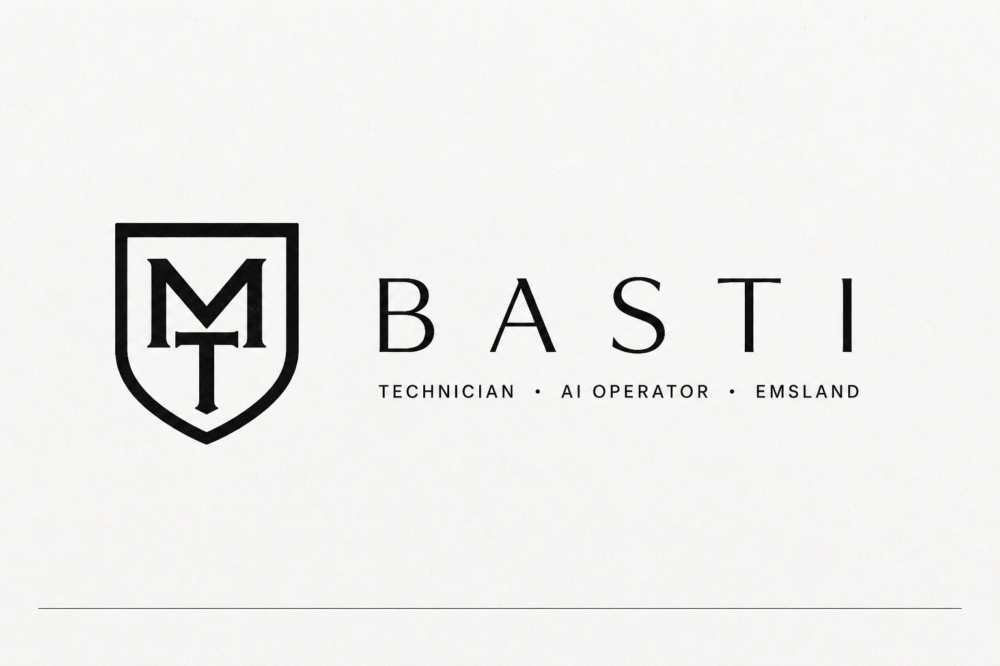

<p align="center">
  
</p>

<p align="center">
  <a href="https://moodtechsolutions.com"></a>
  <a href="mailto:basti@moodtechsolutions.com"></a>
  <a href="https://pypi.org/project/agentbell/"></a>
</p>

### Technician. Not a developer.

I don't write the code. I specify, review and ship. Agents build.

My job is the part around the code: what gets built, whether it works, and whether it is safe to ship.
My daily drivers are Claude Code, Codex and OpenCode.

---

### 🔔 Flagship: [agentbell](https://github.com/MoodTechBasti/agentbell)

**Push notifications and phone approvals for AI coding agents.** Free, single Python file, no dependencies, no server or account needed.

How many times today have you checked whether your agent is done yet? agentbell tells your phone when an agent finishes, fails or needs you, and lets you answer from there.

- **Pushes to your phone** via [ntfy](https://ntfy.sh) when a turn finishes, fails or waits for input
- **Approve or deny from your phone:** `agentbell ask "Deploy to production?"`
- **Watches any command:** `agentbell watch -- npm run build`
- **Hooks** for Claude Code, Codex, OpenCode, Gemini CLI, Kimi Code and Qwen Code, **rule files** for Cursor, Windsurf, Cline, Continue, Zed and Aider
- **MCP server** and **webhook** for editors, CI jobs and remote machines

```bash
pipx install agentbell
agentbell init
```

Built with agents, used every day on my own agent runs. MIT licensed.

---

### 🛠️ What else I'm building

| Project | What it is | Status |
|---|---|---|
| **RiftRaze** | Godot 4 survivor-like. Terrain is the weapon. Steam is the target. | in development (private) |
| **[MoodTech Solutions](https://moodtechsolutions.com)** | Websites, local SEO and automation for businesses in Emsland | client work (private) |
<!-- Add future public repos here as rows, e.g.:
| **[repo-reel](https://github.com/MoodTechBasti/repo-reel)** | one-line description | public |
| **[beatframe](https://github.com/MoodTechBasti/beatframe)** | one-line description | public |
| **[moodvector](https://github.com/MoodTechBasti/moodvector)** | one-line description | public |
-->

<!-- Optional section once agentic-development-manifest / agent-ops are public:
### 🤖 How I work with agents

- [agentic-development-manifest](https://github.com/MoodTechBasti/agentic-development-manifest): the rules my agents work by
- [agent-ops](https://github.com/MoodTechBasti/agent-ops): one-line description
-->

---

### 📌 Rule for this profile

What goes public here is only what I actually use.

<sub>Northern Germany · <a href="https://moodtechsolutions.com">MoodTech Solutions</a></sub>
